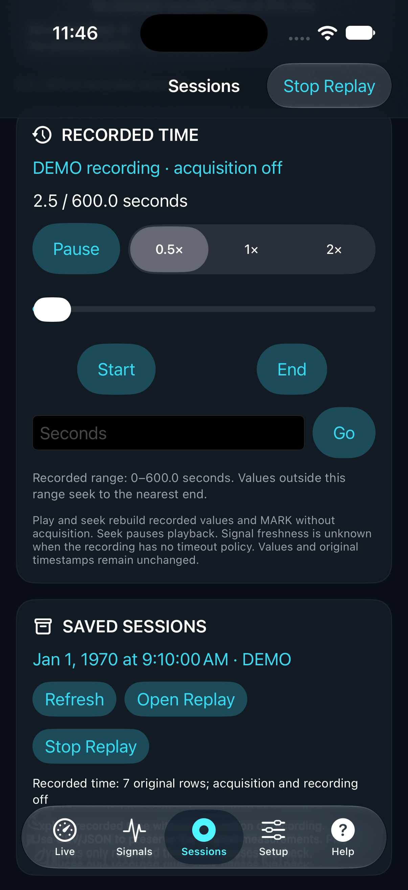
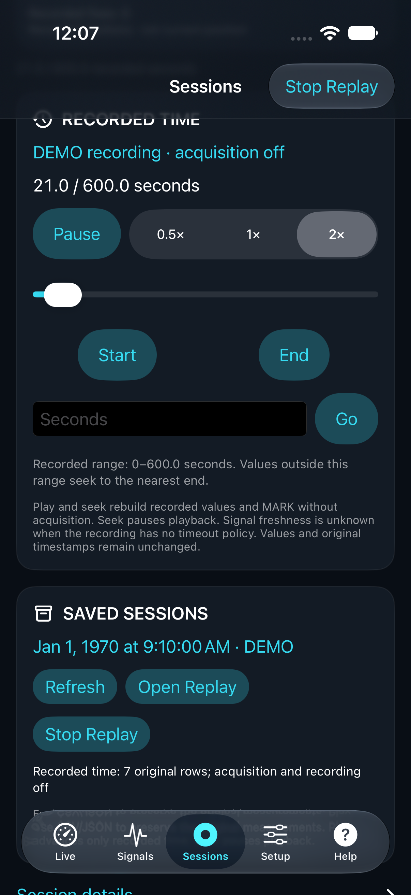

# REP-02 Replay Rate Input Fix

## Scope

Synthetic iPhone 17 / iOS 27.0 Simulator, Xcode 27.0 (27A266a), App 0.22.5 (21).
Base main: `6ec1376409546cb6e9d2bdc14bed04c0498fa2f2`.
Verified application change: `mobile-ios/App/SessionsView.swift`, SHA256 `dfd843b1db2fbb66494749eb92187e42e34f02ff74ddb4d0c0488feb11791eab`.
Tests used the tracked source export plus this file and the existing opt-in export-dismissal fixture transform. Unrelated user WIP was excluded and preserved.

This is a development fix, not a packaged release, physical ELM/CAN/GPS test or CarPlay qualification. Version/build were not incremented and no installer/upload was produced.

## Reproduction And Change

- Historical CI failed the active fast-rate assertion in cycle 2. A new pristine local execution passed once, then failed the first active fast-rate assertion at line 501. An observed execution passed once, then failed the same rate path at line 507 in cycle 0. Different iteration, same erroneous retained 0.5x state.
- Failure video frames were directly inspected. The screen retained 0.5x and continued slowly, not merely a stale accessibility selection or frozen playback.
- Actual tap/receipt correlation found five rate intents with only four correct deliveries in the failing run: a 2.0 tap produced a 0.5 Picker proposal. Model and Controller correctly accepted that 0.5. The clock guard did not reject a 2.0 request; none reached it for that tap.
- The Picker was inside a subtree invalidated by playback position updates. The fix introduces a narrow Equatable view boundary keyed by rate, enabled state, model identity and language. It retains a dynamic model Binding and the same native segmented control, layout, labels, tags and accessibility identifier. Controller, clocks, waits, raw acquisition and persistence are unchanged.
- Apple's documented `equatable()` behavior supports skipping unchanged child values: [SwiftUI documentation](https://developer.apple.com/documentation/swiftui/view/equatable()). The observed input boundary and successful targeted correction do not establish an Apple-internal UIKit defect.

## Executed Verification

| Verification | Result | Scope |
| --- | --- | --- |
| Original unmodified playback UI test after fix | PASS 3/3 | 84.332s, 86.844s, 79.988s; no rate assertion wait increase |
| Active slider target regression | PASS 1/1 | 51.298s; captured seek target preserved |
| Existing large-text/landscape UI test | PASS 1/1 | 121.182s; layout audit only, includes a zero-range fixture |
| Current tracked Core package | PASS 474/474 | Fresh execution at 2026-11-17 00:13:04 KST, no failures |
| Captured input/acceptance verifier tests | PASS 9/9 | Includes actual success/failure, incomplete/mismatched capture, safe errors and Python `-O` |
| Platform docs and scoped whitespace | PASS | No server/mobile/Android implementation changes |
| Synthetic recording invariance | PASS | All fields of 6 sessions and 26 measurement rows unchanged after actual UI replay |
| Physical iPhone / vehicle / CarPlay | NOT TESTED | No promotion from Simulator evidence |

The local debug helper had killed its own child after two warning-pressure readings. That was not an OS termination or authorization boundary. Read-only Apple XNU/dispatch references distinguish warning from critical: [kernel conversion](https://github.com/apple-oss-distributions/xnu/blob/main/bsd/kern/kern_memorystatus_notify.c). The tested debug policy retains critical/unknown-probe stops, local memory reserves, bounded runtime and explicit stop, while warning alone is advisory. These local reserve thresholds are not Apple requirements. No OS settings or pressure injection changed.

The shared Simulator was read-only inspected and was visibly recording. It was not installed over, tapped, stopped or shut down. All execution used one separately owned synthetic Simulator.

## Reproducible Captured Contract

These commands validate captured evidence; they do not launch the app or replace native UI execution:

```sh
python3 scripts/tests/test_replay_rate_intent.py -v
python3 scripts/verify_replay_rate_intent.py scripts/fixtures/replay_rate_intent/pass-ui.txt scripts/fixtures/replay_rate_intent/pass-rates.txt
python3 scripts/verify_replay_rate_intent.py scripts/fixtures/replay_rate_intent/failure-ui.txt scripts/fixtures/replay_rate_intent/failure-rates.txt
```

The last command intentionally exits 1 with `FAIL`, `tapCount=5`, `correctCount=4`, while `controllerAcceptedAll=true`. It must not be treated as a passing UI result. Fixtures are minimal actual synthetic captures with original relative timing, hashes and no user vehicle/location/credentials.

## Visual Evidence And Limits

The primary agent directly opened the original failure frames, fixed active/end frames and large portrait/landscape controls. Review details are in [the visual record](../ui-visual-review.md). Original unedited images and source hashes are in [the capture record](../evidence/replay-rate-2026-11-17/capture.json).





## Remaining Gates

- This small synthetic regression sample is not whole-product UI/UX, physical-device or endurance acceptance. The whole-feature denominator remains UNDER_MAPPING; REP-02 evidence does not make all 99 candidates complete.
- A separate landscape Go-result attachment was black/unusable. The following landscape-controls frame was readable and directly reviewed; the black attachment is not visual verification. Other generated menu captures were not inspected.
- The Help source audit detects changed `SessionsView.swift` lineage. Help assets were not rehashed or regenerated. Refresh actual capture provenance at the approved later gate before release qualification.
- Existing unrelated user changes and pending hosted tests remain. Overall native suite, real vehicle/CAN/GPS, physical UI and CarPlay registration/entitlement/runtime gates are not completed here.
- Remote synchronization remains separate: the earlier unpublished metadata commit has an email-privacy rejection and explicit amend authorization is still pending. No force push/amend/global privacy change was made.
- Native goal editing is officially supported by `thread/goal/set`, but no connected forwarding route is exposed here. No new goal, false completion, DB edit or daemon was used; backend status is not evidence that independent execution stopped.
